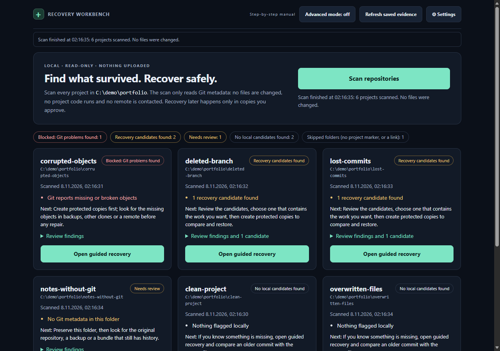

# MOORKYZ Repo Recovery

**Find what survived. Recover safely.** A local-first workbench that scans your
Git repositories read-only, shows which lost commits and files still exist, and
walks you through restoring them on verified independent copies — without ever
changing the original.



- **One-click assessment:** scan every project under a folder; get evidence-backed
  findings (Git errors, missing tracked files, uncommitted work, no history) and one
  recommended next step per project.
- **Recovery candidates:** commits that survive only in the reflog (after
  `reset --hard` or a deleted branch), dangling commits, stashes, existing recovery
  refs and recent history, compared with the current version and ordered by
  listed evidence — never by an invented probability.
- **Guided recovery:** protect an untouched backup and a working copy, check
  integrity, preview and restore individual files, run approved tests, validate and
  export a Markdown report.
- **Advanced mode:** every manual procedure of the full workbench (fix scripts,
  recovery branches, remote import, custom validation, estimates, diagnostics) stays
  one click away.

## Safety promise

- The scan reads Git metadata only. It never writes to a project, runs project code,
  installs packages or contacts a remote.
- Every change is previewed and needs explicit approval. Changes are applied only to
  a verified disposable working copy. Originals and backups are re-hashed and must be
  unchanged before a result is accepted.
- No reset, clean, prune, push, publish or deploy exists in the workflow.
- Approved project tests are **not sandboxed**: they run with your permissions. You
  see the exact command and declared script text before approving.
- The server listens on `127.0.0.1` only, with a per-session token and same-origin
  checks. Nothing is uploaded.

If the data you need no longer exists in any local Git object, reflog or copy, the
tool says so. It does not generate replacement code.

## Quick start

Requirements: [Node.js](https://nodejs.org/) 22.13 or newer (24 LTS recommended) and
Git on `PATH`. No `npm install`, no build step, no dependencies.

```powershell
git clone https://github.com/Moorky/moorkyz-repo-recovery.git
cd moorkyz-repo-recovery
node scripts/demo.mjs ../recovery-demo          # optional: synthetic damaged repositories
node src/dashboard/server.mjs --root ../recovery-demo/portfolio --open
```

On Windows you can also double-click `DASHBOARD.cmd`; it asks for the folder that
contains your repositories. Press **Scan repositories**, open a project card, and
follow the guided steps. See the [5-minute quick start](docs/QUICKSTART.md) for the
full demo walkthrough, including the lost-commit recovery.

## What is supported

| Supported | Requires your review | Not supported |
|---|---|---|
| Local Git repositories and plain project folders up to two levels below the scan folder | Choosing which candidate contains the work you want | Recovering data that exists in no local object, reflog or copy |
| Reflog-only, dangling, stash and recovery-ref commits; recent branch history | Every copy, file restore, validation command and remote contact (explicit approval) | Deleted-disk, browser/IndexedDB, cloud-history or media recovery |
| Byte-verified backup + working copy, one-file-at-a-time restore (≤ 64 MiB) | Running project tests (not sandboxed) | Automatic merge, reset, rebase, push or deploy |
| Node package tests; reviewed Python, PowerShell, .NET and nested commands (Advanced) | Moving the recovered result into your original | Linked-worktree, external-gitdir and object-alternates copies (reported, not copied) |
| Optional HTTPS/local remote import into a new namespace of the working copy (Advanced) | SSH or custom remote transports | AI-generated reconstruction or recovery-probability scores |

Platforms: verified on Windows 11 with Node 22.13.0, 22.18.0 and 24.22.2. Linux and
macOS run in the configured CI matrix; see [readiness](docs/READINESS.md) for the
latest recorded results.

## Commands

```powershell
npm start                     # dashboard on the parent folder of this checkout
npm test                      # unit, integration, HTTP and browser end-to-end tests
npm run lint                  # documentation links and preserved-source hashes
npm run smoke                 # fresh-start smoke test on a synthetic demo
node scripts/demo.mjs <new-folder>          # create the synthetic demo portfolio
node scripts/package.mjs <existing-folder>  # release source ZIP + SHA-256
node src/recovery.mjs assess --root <folder> --output <new-external-folder>  # Markdown/JSON report from the CLI
```

The browser end-to-end test drives an installed Edge or Chrome in headless mode
(no npm dependency) and is reported as skipped when no Chromium browser exists.
Set `RECOVERY_BROWSER` to a browser executable to choose one.

## Documentation

| Read | For |
|---|---|
| [Quick start](docs/QUICKSTART.md) | First run with the synthetic demo |
| [Operator manual](docs/USER_GUIDE.md) | Simple mode, every advanced procedure, troubleshooting |
| [Guided recovery](docs/GUIDED_RECOVERY.md) | The supervised workflow and its approval boundaries |
| [Architecture](docs/ARCHITECTURE.md) | Components, data flow, trust boundaries and tests |
| [Readiness](docs/READINESS.md) and [release readiness](docs/RELEASE_READINESS.md) | What is verified, limits and the go/no-go evidence |
| [Dashboard reference](docs/DASHBOARD.md) and [tooling](docs/TOOLING.md) | Statuses, scoring contract, CLI commands |
| [Security](SECURITY.md) and [contributing](CONTRIBUTING.md) | Threat boundaries, reporting, development workflow |
| [Release roadmap](docs/RELEASE_ROADMAP.md) | Long-term plan; MVP versus deferred features |
| [Documentation map](docs/README.md) | Everything else, including the recovery handbook |

## Status

Version 0.4.0 is the open-source MVP candidate. It is not a v1.0 release and no
release tag has been published. See [release readiness](docs/RELEASE_READINESS.md)
for the evidence and the remaining owner decisions, and the
[changelog](CHANGELOG.md) for changes.

## Project layout

| Location | Purpose |
|---|---|
| `src/` | Read-only CLI (`recovery.mjs`) and the dashboard server, engine and procedures (`src/dashboard/`) |
| `website/` | Dependency-free UI: Simple mode (`simple*.mjs`) and the Advanced workbench |
| `scripts/` | Project checks, demo builder, smoke test, packaging, screenshots, headless-browser driver |
| `tests/` | `node --test` suites on disposable synthetic repositories |
| `docs/` | Manuals, decisions, templates, roadmap; `docs/assets/` holds demo screenshots |
| `.github/workflows/` | CI matrix (Windows, Linux, macOS × Node 22.13.0 and 24) |
| `.audits/` | Reviewed change records |

## The owner's portfolio

This repository started as the recovery workbench for the owner's own projects.
Those records remain for provenance and are not needed to use the tool:
[publication status](PUBLICATION_STATUS.md), the dated
[portfolio assessment](PROJECT_RECOVERY_ASSESSMENT.md) and
[portfolio repair results](PORTFOLIO_REPAIR_RESULTS.md) (owner-local; omitted from
the source ZIP), the [recovery handbook](docs/RECOVERY_HANDBOOK.md),
[portfolio triage](docs/PORTFOLIO.md) and [owner decisions](docs/OWNER_DECISIONS.md).
Historical inputs under `docs/sources/` are Git-ignored and private.

**Never treat an inventory as a backup**, and never run a repair against the only
surviving copy.

## License

[Apache License 2.0](LICENSE). The bundled DM Mono font is under the
[SIL Open Font License](website/fonts/OFL.txt).
